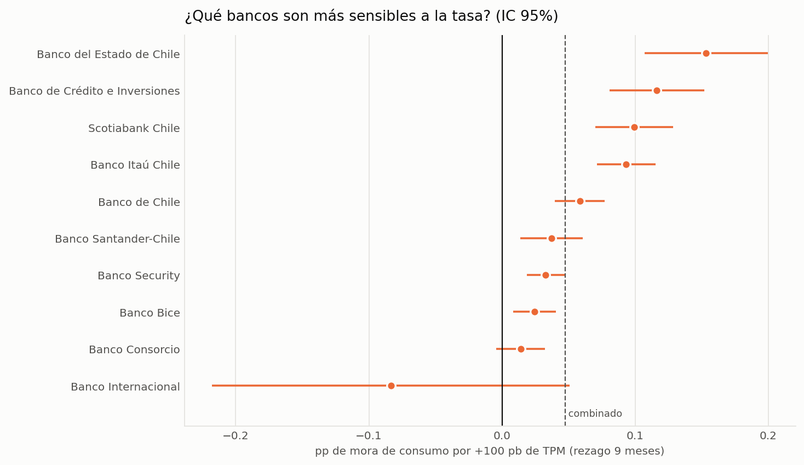
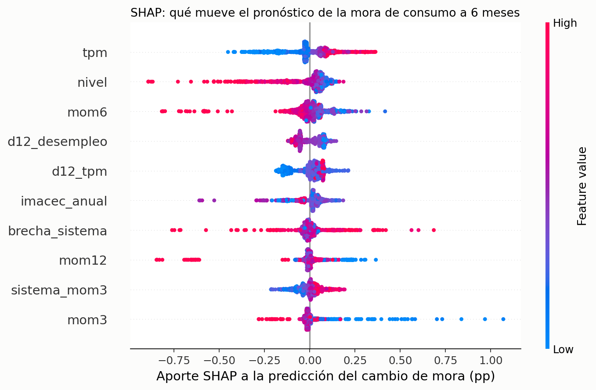
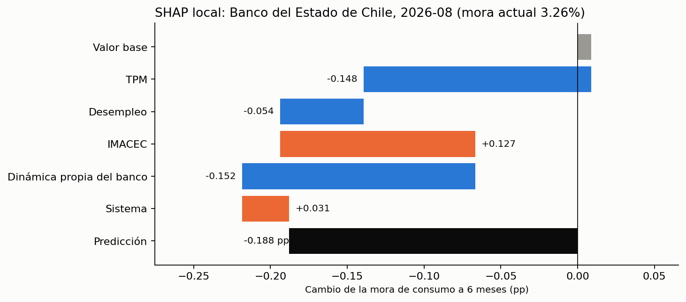

# Morosidad bancaria en Chile, 2016–2026 — un panel mensual con datos de la CMF

Español · [English version](README.md)


**[Página interactiva](https://rxyxs.github.io/chile-banking-delinquency-cmf/)**: explora cualquier banco frente al sistema y lee los resultados del pronóstico.

## Por qué este proyecto

La morosidad bancaria es lo primero que se pregunta cuando se quiere saber si el crédito en Chile se está deteriorando, y la CMF la publica todos los meses. Pero la publica en **128 archivos Excel separados**, uno por mes, con **tres formatos distintos**. Quise convertir eso en un solo panel limpio y responder siete preguntas que un analista recibe de verdad:

1. ¿Qué tan grande fue la caída de la mora durante el COVID y cuánto ha vuelto?
2. ¿El alza reciente es un deterioro de *todo el sistema*, de unos pocos bancos, o un cambio en quién presta?
3. ¿Un modelo simple pronostica la mora del próximo trimestre mejor que "igual que hoy"?
4. ¿Mejoran esos pronósticos los indicadores macro (desempleo, tasa de política monetaria, IMACEC)?
5. ¿Se puede pronosticar la mora de un banco en particular, tomando información entre bancos?
6. Ante un escenario macro de estrés, ¿cuánto subiría la mora, y se puede confiar en ese modelo?
7. ¿Le va mejor a un modelo de machine learning, y en qué se apoya?

Todo corre con un solo comando y cada número de abajo sale de esa corrida.

## Datos

Fuente: [CMF Chile — *Indicador de morosidad de 90 días o más individual del Sistema Bancario*](https://www.cmfchile.cl/portal/estadisticas/626/w4-propertyvalue-28914.html). Público, sin clave de API.

| | |
|---|---|
| Meses | 128 (2016-01 → 2026-08) |
| Filas | 2.453 (banco × mes) |
| Entidades | 24 bancos + la fila oficial "Sistema Bancario" |
| Medida | % de colocaciones con 90+ días de atraso, para total, comercial, personas, consumo y vivienda; más el monto moroso en MM$ |

El panel limpio, que es pequeño, está versionado en [`data/panel_mora90.csv`](data/panel_mora90.csv): los tests y las corridas con `--offline` no necesitan red. Los `.xlsx` originales se descargan al ejecutar y no se versionan.

**Indicadores macro (hallazgo 5).** Desempleo, tasa de política monetaria (TPM) e IMACEC mensuales desde [mindicador.cl](https://mindicador.cl), una API abierta que replica series del Banco Central y del INE. Es un agregador de terceros, no el publicador oficial, así que las cifras pueden diferir de las oficiales o revisarse después; uso los valores tal como estaban al descargarlos (2026-10-03), no versiones en tiempo real. La tabla, pequeña, está versionada en [`data/macro_indicators.csv`](data/macro_indicators.csv). El IPC queda fuera porque la API solo lo entrega hasta 2025-12.

**Composición de cartera por banco (hallazgos 7 y 8).** Colocaciones comerciales, de consumo (con tarjetas) y de vivienda de cada banco, en MM$, del [*Reporte Financiero Mensual*](https://www.cmfchile.cl/portal/estadisticas/626/w4-propertyvalue-28910.html) de la CMF, hoja "Activos Bancos 2", diciembres de 2019 a 2025. El parser lee el formato anterior a 2022 y el del nuevo compendio contable ubicando los encabezados. La tabla está versionada en [`data/loan_mix.csv`](data/loan_mix.csv).

### Cosas que hacen los archivos y que un lector ingenuo interpretaría mal

- **Tres formatos.** 2016-01–2021-12 (9 columnas, nombre del banco en la columna A), 2022-01–2023-03 (12 columnas, sin encabezados de texto en el bloque de %) y 2023-04 en adelante (12 columnas con encabezados). El parser detecta el formato y **no adivina**: si los encabezados esperados no están donde corresponde, falla con un error.
- **Sin quiebre en el cambio de 2022.** El total del sistema pasa de 1,259% a 1,273% entre 2021-12 y 2022-01, así que el cambio de formato no es un cambio de definición (hay un test para eso).
- **`---` no es cero.** Significa que el banco no tiene esa cartera. Se conserva como `NaN`.
- **Fusiones y cambios de nombre.** `Itaú Corpbanca` pasó a llamarse `Banco Itaú Chile`; `BBVA Chile` pasó a `Scotiabank Azul`; `Jp Morgan…` y `JP Morgan…` difieren solo en mayúsculas. El `Banco Itaú Chile` *antiguo* de 2016-01 a 2016-03 es otra entidad, previa a la fusión, y se excluye de la serie continua.
- **Un hueco real en la fuente.** En el archivo de 2023-07 la CMF dejó la fila "Sistema Bancario" en `---` aunque los 18 bancos sí vienen. Ese único mes se interpola linealmente y queda marcado (`imputed`); un hueco de más de un mes levanta un error en vez de inventarse.

## Hallazgos

### 1. El alivio del COVID fue grande y se revirtió por completo

| Régimen | Total sistema (promedio) | Comercial | Consumo | Vivienda |
|---|---|---|---|---|
| Pre-COVID (2016-01 → 2020-02) | 1,94% | 1,67% | 1,99% | 2,48% |
| Alivio COVID (2020-03 → 2021-12) | 1,65% | 1,73% | 1,46% | 1,60% |
| Normalización (2022-01 →) | 2,14% | 2,30% | 2,18% | 1,94% |

La mora del sistema era **2,04% en febrero de 2020**, cayó a un mínimo de **1,26% en diciembre de 2021** (−0,78 pp) y está en **2,44% en agosto de 2026**: un rebote de **+1,18 pp**, que termina **0,40 pp por sobre el punto de partida**. Las carteras no se movieron juntas. El crédito a hogares osciló mucho más que el comercial:

| Cartera | Feb 2020 | Mínimo | Ago 2026 | Caída hasta el mínimo | Rebote desde entonces |
|---|---|---|---|---|---|
| Comercial | 1,90% | 1,42% (2021-12) | 2,34% | −0,47 pp | +0,92 pp |
| Consumo | 2,17% | 0,98% (2021-10) | 2,35% | −1,18 pp | +1,36 pp |
| Vivienda | 2,30% | 1,04% (2022-03) | 2,65% | −1,26 pp | +1,61 pp |

La mora hipotecaria es hoy la más alejada de su nivel pre-COVID entre las carteras de hogares (+0,35 pp, contra +0,18 pp de consumo), y la comercial muestra la mayor brecha frente a febrero de 2020 de las tres (+0,45 pp), aunque fue la que menos osciló.

### 2. El alza desde el mínimo es deterioro dentro de los bancos, no un cambio de quién presta

Descomponiendo el cambio de +1,25 pp entre diciembre de 2021 y agosto de 2026 en cambio *dentro de cada banco* y cambio de *mezcla* (Kitagawa, sobre los 11 bancos presentes en ambas fechas, que cubren entre 96 y 99,7% de las colocaciones):

| Componente | pp |
|---|---|
| Deterioro dentro de los bancos | **+1,27** |
| Mezcla (cambios de participación de mercado) | −0,02 |
| Total | +1,25 |

Tres bancos explican cerca de dos tercios: **Santander-Chile (+0,36 pp), Banco del Estado (+0,33 pp) y Scotiabank Chile (+0,17 pp)**.


### 3. Los bancos convergen en una crisis y divergen en una recuperación

La dispersión entre bancos en mora de consumo (rango intercuartil) tuvo su máximo de **2,14 pp en julio de 2024** y hoy es de **0,42 pp**. El *orden* de los bancos es moderadamente persistente: la correlación de rangos de Spearman de la mora de consumo entre diciembre de 2019 y agosto de 2026 es **0,69**.


### 4. Ganarle a "igual que hoy" es difícil, y la evidencia es escasa

Backtest con origen móvil sobre el total del sistema (primer pronóstico tras 60 meses de historia, 68 orígenes al horizonte de 1 mes). Métrica: MAE relativo al pronóstico ingenuo (1,0 = igual que el ingenuo), con intervalo de 95% por bootstrap de bloques.

| Horizonte | ARIMA(1,1,1) | ETS amortiguado | Deriva 24 meses |
|---|---|---|---|
| 1 mes | 0,94 [0,87; 1,02] | 0,98 [0,88; 1,08] | 1,04 [0,90; 1,22] |
| 3 meses | **0,83 [0,73; 0,95]** | 0,85 [0,71; 1,00] | 1,05 [0,79; 1,37] |
| 6 meses | 0,88 [0,75; 1,03] | 0,87 [0,70; 1,06] | 1,12 [0,72; 1,64] |
| 12 meses | 0,94 [0,83; 1,14] | 0,91 [0,77; 1,15] | 1,39 [0,89; 2,63] |

**Solo ARIMA a 3 meses tiene un intervalo que excluye el 1.** En el resto no puedo demostrar ventaja sobre el ingenuo, y extrapolar la tendencia reciente (deriva) es *peor* en horizontes largos. El pronóstico estacional ingenuo es mucho peor (rMAE 8,4 a 1 mes): la mora no tiene una estacionalidad estable.


### 5. Los indicadores macro no mejoran el pronóstico

Probé tres indicadores mensuales: desempleo, tasa de política monetaria e IMACEC (variación anual). El desempleo y el IMACEC se rezagan un mes por publicación, de modo que un pronóstico solo usa lo que se sabía en su origen.

**Sí se mueven antes que la mora, con signos que requieren cuidado.** Correlación entre el cambio a 12 meses de la mora y el cambio a 12 meses de cada indicador, con el indicador adelantado *k* meses (116 observaciones solapadas):

| Indicador | Mismo mes | Adelantado 6 meses | Adelantado 12 meses |
|---|---|---|---|
| Tasa de política monetaria (TPM) | −0,14 | +0,39 | **+0,67** |
| Desempleo | +0,16 | −0,27 | **−0,51** |
| IMACEC (variación anual) | −0,40 | −0,34 | −0,11 |


- La tasa de política monetaria, un año antes, se correlaciona fuerte con el alza de la mora: consistente con que las alzas de tasa se traspasan a los deudores, lo que no probé como afirmación causal.
- El desempleo tiene el signo *equivocado* en los rezagos largos. El desempleo subió con fuerza en 2020 mientras la mora caía, por las medidas de alivio, y ese episodio domina una muestra tan corta.
- Son cambios sobre ventanas de 12 meses solapadas, así que las correlaciones vecinas no son independientes y no doy p-valores. Es una descripción, no una prueba.

**Pero agregarlos empeora los pronósticos.** Pronósticos directos a cada horizonte (mínimos cuadrados del cambio futuro sobre las features de hoy), con el mismo protocolo de origen móvil del hallazgo 4 (68 orígenes a un mes). La referencia es el mismo modelo sin macro, así que la tabla aísla lo que aportan los indicadores. Menos de 1 es mejor.

| Horizonte | Solo momentum, vs ingenuo | + desempleo, vs solo momentum | + desempleo, TPM e IMACEC, vs solo momentum |
|---|---|---|---|
| 1 mes | 0,95 [0,87; 1,06] | 1,11 [1,01; 1,21] | 1,14 [1,03; 1,27] |
| 3 meses | **0,82 [0,70; 0,97]** | 1,24 [1,04; 1,47] | 1,30 [0,99; 1,70] |
| 6 meses | 0,98 [0,80; 1,13] | 1,22 [0,97; 1,47] | 1,21 [0,73; 1,95] |
| 12 meses | 1,13 [1,02; 1,28] | 1,12 [0,89; 1,24] | 1,10 [0,61; 1,91] |


- Agregar macro sube el error entre 10 y 30% respecto de usar solo el momentum. A 1 y 3 meses con desempleo, y a 1 mes con los tres indicadores, el intervalo excluye el 1: es peor, no solo "no mejor". En el resto los intervalos incluyen el 1.
- El momentum solo (el cambio de los últimos tres meses) le gana al ingenuo únicamente a 3 meses (0,82, casi igual que el ARIMA del hallazgo 4) y es *peor* que el ingenuo a 12 meses.
- **No probé por qué el macro perjudica.** Una causa plausible es que en las ventanas de entrenamiento el alivio del COVID invirtió el vínculo habitual entre desempleo y mora, así que los coeficientes aprendidos ahí inducen a error después; la fila de desempleo de la tabla de correlaciones es el síntoma. Con 60 a 120 meses, tres regresores adicionales también pueden simplemente sobreajustar.

### 6. Los bancos individuales se parecen a un paseo aleatorio

Pronosticar la mora de un banco es más difícil que pronosticar la del sistema: cada serie es corta y ruidosa. Una idea natural es tomar información entre bancos con una sola regresión agrupada cuyas features incluyen la **brecha del banco respecto del sistema** (¿un banco muy por sobre el sistema tiende a volver hacia él?) y el momentum del propio sistema. La probé en los 10 bancos con al menos 100 meses de datos y una participación mediana de al menos 1% de las colocaciones del sistema. El resto son sucursales de bancos extranjeros y bancos pequeños cuya mora salta de 0% a 4% con un solo crédito y dominarían cualquier error promedio.

Mismo protocolo que el hallazgo 4 (68 orígenes a un mes). La tabla da el error absoluto medio entre bancos relativo al pronóstico ingenuo, con un bootstrap de bloques que remuestrea por mes (los bancos de un mismo mes comparten el shock del mes, así que remuestrear banco por banco subestimaría la incertidumbre). Menos de 1 es mejor.

| Horizonte | Error del ingenuo (pp) | ETS por banco | Agrupado: momentum + brecha | Agrupado: también momentum del sistema |
|---|---|---|---|---|
| 1 mes | 0,09 | 1,01 [0,99; 1,03] | 1,01 [0,99; 1,02] | 0,99 [0,97; 1,00] |
| 3 meses | 0,16 | 0,99 [0,97; 1,01] | 1,00 [0,98; 1,03] | **0,96 [0,92; 1,00]** |
| 6 meses | 0,24 | 0,98 [0,94; 1,03] | 1,00 [0,97; 1,05] | 0,98 [0,91; 1,04] |
| 12 meses | 0,33 | 0,99 [0,94; 1,06] | 1,06 [1,03; 1,15] | 1,08 [1,03; 1,17] |


- **Ningún modelo le gana con claridad a "igual que hoy" en ningún horizonte.** El más cercano es el agrupado con el momentum del sistema a 3 meses (0,96), cuyo intervalo toca 1,00.
- **La brecha respecto del sistema no aporta nada.** Comparar el modelo agrupado con la brecha contra el mismo modelo sin ella da 1,00 en todos los horizontes hasta 6 meses (intervalos dentro de 0,98 a 1,02): no hay evidencia de reversión hacia el nivel del sistema en esta muestra. Comprobé que el método puede verla cuando existe: en bancos sintéticos construidos con 15% de reversión mensual recorta el error 13% (0,87 [0,81; 0,94]), y sin reversión no lo hace (1,04 [1,01; 1,08]).
- **A 12 meses los modelos agrupados son peores** que el ingenuo (1,06 y 1,08, intervalos sobre 1).
- **ETS es casi idéntico al ingenuo** porque una tendencia amortiguada sobre estas series suaves queda casi plana.


Banco por banco a 6 meses, dos intervalos del modelo agrupado excluyen el 1: Banco Consorcio (0,87 [0,81; 0,92]) y Scotiabank Chile (0,88 [0,77; 0,98]). Con 20 intervalos (10 bancos, 2 modelos), es esperable que uno o dos queden fuera por azar, así que no los leo como bancos predecibles.

Límites: solo la mora total, 10 bancos, sin corrección por comparaciones múltiples, y los errores son pequeños en términos absolutos (0,09 a 0,33 pp), así que una ventaja de 2 a 4% son unas pocas centésimas de punto porcentual.

### 7. Prueba de tensión: las tasas mueven la mora de consumo; los datos no dicen qué haría una recesión

El hallazgo 5 preguntaba si la macro ayuda a *pronosticar*. Una prueba de tensión hace otra pregunta, condicional: *si* las tasas, el desempleo y la actividad se movieran así, ¿dónde quedaría la mora? Estimo una regresión satélite por cartera sobre la serie del sistema y luego la simulo.

```
cambio a 12 meses de la mora_t = a + b1·Δ12 TPM_{t-L} + b2·Δ12 desempleo_{t-L} + b3·IMACEC anual_{t-L} + e_t
```

Hay cuatro decisiones de modelado, y cada una la obliga algo que aparece en los datos:

- **La ventana de alivio COVID (2020-03 a 2021-12) se excluye de la estimación.** Si se incluye, el desempleo sale con el signo *equivocado* (−0,15 pp de mora de consumo por cada pp de desempleo, t = −12,3): la mora bajó mientras el desempleo subía con reprogramaciones, retiros de AFP y transferencias. Un escenario de estrés sin esos programas no debería heredar eso.
- **El rezago L se elige por cartera** entre 0, 3, 6, 9 y 12 meses, según el R² ajustado sobre una muestra común. Mi primera versión fijaba L = 6 después de mirar los datos. Fijar el rezago a posteriori hace ver al modelo mejor de lo que es: en consumo, un rezago fijo de 6 meses da 0,53 contra el 0,73 honesto (ver abajo). Ahora el rezago se vuelve a elegir en cada origen del backtest, solo con el pasado.
- **Restricciones de signo.** El desempleo y el IMACEC se mueven juntos (correlación −0,77), e incluso fuera del COVID sus coeficientes por separado salen con signos económicamente equivocados. Sin restricción, el modelo dice que una recesión *baja* la mora de consumo. Si un factor sale con signo equivocado, se elimina (coeficiente 0) y se reestima, y el motor informa qué factores eliminó.
- **Errores Newey-West (12 rezagos)**, porque los cambios a 12 meses se solapan. El Monte Carlo sortea los coeficientes de esa covarianza y remuestrea los residuos históricos (10.000 sorteos, semilla fija). La EAD son las colocaciones implícitas reales de 2026-08 (250 billones de CLP). La LGD es un supuesto: una Beta con media 45% (el valor supervisor de Basilea para deuda senior no garantizada).

| Cartera | Rezago | R² | Δ12 TPM (por pp) | IMACEC anual (por %) | Eliminado por signo |
|---|---|---|---|---|---|
| Total | 9 | 0,57 | +0,039 (t 4,2) | −0,022 (t −4,6) | desempleo |
| Comercial | 12 | 0,67 | +0,059 (t 10,3) | −0,009 (t −1,8) | desempleo |
| **Consumo** | 9 | **0,80** | **+0,095 (t 9,4)** | — | desempleo, IMACEC |
| Vivienda | 3 | 0,18 | — | −0,021 (t −1,3) | TPM (el desempleo queda: +0,075, t 1,4) |

**¿Funciona fuera de muestra?** Para cada mes entre 2023-01 y 2026-08 reestimo con datos hasta 12 meses antes, incluidas la elección del rezago y las restricciones de signo. Luego le entrego la macro que efectivamente ocurrió y comparo con "la mora no cambia". Las barras muestran el puntaje honesto, con el rezago elegido con el pasado. Los puntos grises muestran lo que habría dado cada rezago fijo; elegir el mejor punto después de verlo es la fuga que yo tenía.


- **Consumo: 0,73** (0,26 pp contra 0,36 pp, 44 meses). Le gana a "sin cambio", aunque por menos de lo que sugería la versión con rezago fijo.
- **Comercial: 0,85.** También le gana, una vez eliminado el término de desempleo con signo equivocado.
- **Total: 1,12; vivienda: 1,53.** Ninguna le gana a "sin cambio", así que leo esos escenarios como ilustración.
- **El rezago pesa tanto como el modelo.** Con un rezago fijo de 12 meses, total y comercial darían 0,74 y 0,57, y consumo daría 0,53 con 6 meses. Ninguno de esos rezagos se puede elegir honestamente por adelantado.

**¿El efecto de la tasa es estable?** Estimando la mora de consumo solo con datos pre-COVID (2017–2020, cuando la TPM casi no se movió: entre −1 y +0,5 pp) se obtiene +0,14 pp por pp (t = 3,0), contra +0,08 (t = 9,4) desde 2022. El signo y el tamaño se mantienen, pero la precisión viene casi entera del ciclo 2022–23.

**¿Qué bancos están más expuestos?** El mismo modelo, banco por banco, sobre los 10 bancos con historia y tamaño suficientes:



BancoEstado (+0,15 pp por cada 100 pb), BCI (+0,12), Scotiabank (+0,10) e Itaú (+0,09) reaccionan entre tres y diez veces más que Bice (+0,02), Consorcio (+0,01) y Security (+0,03). La hipótesis de que todos los bancos comparten un mismo coeficiente se rechaza con holgura (Q de Cochran = 94 con 9 gl), aunque la Q exagera la evidencia porque los bancos comparten el mismo ciclo. **¿Lo explica la composición de la cartera?** Los archivos de mora solo entregan porcentajes, así que tomé las colocaciones de cada banco por cartera de una segunda fuente de la CMF, el *Reporte Financiero Mensual* (hoja "Activos Bancos 2", diciembres de 2019 a 2025, en ambos formatos contables). La asociación es positiva pero débil, y con 10 bancos ninguna es significativa:

| Rasgo del banco (promedio 2019–2025) | Spearman con la sensibilidad a la TPM | p por permutación |
|---|---|---|
| Consumo / colocaciones totales | 0,55 | 0,11 |
| Tarjetas / consumo | 0,52 | 0,13 |
| Mora de consumo actual | 0,48 | 0,16 |

BancoEstado (7,5% en consumo) y BCI (8,0%) son los más sensibles y tienen *menos* consumo que Santander (14,5%) o el Banco de Chile (13,9%), así que la composición de la cartera no es la explicación. Un canal por ingreso de los clientes es plausible pero no está probado: la CMF no publica el ingreso de los deudores por banco.

**¿Se puede bajar la prueba de tensión a cada banco?** No con estos datos. Fuera de muestra (2023–2026, mismo protocolo), relativo a "sin cambio" y agregando los 10 bancos:

| Cómo se proyecta el cambio a 12 meses de cada banco | MAE relativo |
|---|---|
| Modelo satélite estimado sobre el propio banco | 1,63 |
| Dos etapas: macro → sistema (modelo validado) → banco con su propio beta al sistema | 1,22 |
| La misma segunda etapa, con el cambio *real* del sistema (no es un pronóstico) | 0,98 |

Aun conociendo perfecto la trayectoria del sistema, el beta de un banco al sistema apenas le gana a "sin cambio": la mayor parte del movimiento de un banco es propio, no del ciclo común. La excepción son los grandes prestamistas de consumo, que sí siguen al sistema (BCI 0,53, Scotiabank 0,65, Itaú 0,68 y BancoEstado 0,75 con el cambio real del sistema). Los bancos de nicho no (Consorcio 1,95, Internacional 2,29). Por eso el motor y la API reportan el estrés solo a nivel de sistema, y no publico pérdidas por banco.

**Escenarios**, todos como shocks a 12 meses. Los dos históricos repiten los cambios efectivamente observados en los 12 meses hasta esa fecha:

| Escenario | TPM | Desempleo | IMACEC | Mora consumo | Mora total | Total vs base | Pérdida adicional vs base |
|---|---|---|---|---|---|---|---|
| Base: sin cambios | 0 pb | 0 pp | +2,0% | 2,35% → 2,45% | 2,44% → 2,59% | — | — |
| Histórico: ciclo de alzas 2022 | +725 pb | +0,7 pp | −1,0% | → **3,14%** [2,85; 3,47] | → 2,94% | +0,35 pp | 390 mil MM CLP |
| Histórico: desaceleración 2016 | 0 pb | +0,3 pp | +1,2% | → 2,45% | → 2,61% | +0,02 pp | 20 mil MM CLP |
| Hipotético: alzas con recesión | +300 pb | +2,0 pp | −3,0% | → 2,74% | → 2,82% | +0,23 pp | 256 mil MM CLP |

Los corchetes son los percentiles 5 y 95. El escenario base sube cerca de 0,15 pp porque el intercepto recoge la deriva alcista promedio de la muestra; por eso los efectos se reportan contra el base.

- **La recesión hipotética casi no agrega nada más allá de su alza de tasas.** En consumo se eliminaron los términos de desempleo y actividad, así que el shock de +2 pp de desempleo no tiene efecto. Los datos no contienen una recesión fuera del COVID: la muestra de estimación nunca vio un IMACEC bajo −2,5% ni un desempleo que subiera más de 1,2 pp en un año. Es un límite de los datos, no un hallazgo de que las recesiones sean inocuas. El motor marca los shocks fuera de rango (`out_of_sample_range`) y los factores eliminados (`factors_dropped`).
- **Mora × LGD × EAD es una pérdida sobre el stock moroso, no una pérdida esperada a 12 meses.** La mora 90+ es un stock, no una tasa de default. Las cifras en CLP sirven solo como orden de magnitud y no son una estimación de provisiones.


### 8. El machine learning tampoco le gana a "sin cambio"; SHAP muestra por qué

Los hallazgos 4 a 6 usaron modelos lineales y de suavizamiento exponencial. ¿Le iría mejor a un modelo no lineal a nivel de banco? `models/ml_shap.py` entrena un LightGBM sobre los 10 bancos elegibles para pronosticar el cambio de la mora de cada banco a 3 y 6 meses. Usa la dinámica propia del banco (nivel, cambios a 3, 6 y 12 meses, brecha al sistema), el momentum del sistema y la macro conocida en ese mes, con sus rezagos de publicación. En cada origen desde 2021 se reentrena solo con desenlaces ya conocidos, y se compara con "sin cambio" y con una regresión lineal agrupada sobre los mismos atributos. MAE relativo a "sin cambio", con intervalo de 95% por bootstrap de bloques:

| Cartera | Horizonte | Lineal agrupado | LightGBM |
|---|---|---|---|
| Consumo | 3 meses | 1,66 [1,30; 2,02] | 1,52 [1,34; 1,71] |
| Consumo | 6 meses | 2,31 [1,37; 3,04] | 1,61 [1,38; 1,96] |
| Total | 3 meses | 1,09 [1,02; 1,19] | 1,02 [0,97; 1,08] |
| Total | 6 meses | 1,30 [1,01; 1,55] | 1,03 [0,93; 1,13] |

- **Ningún modelo le gana a "sin cambio".** En consumo ambos son claramente peores. LightGBM es menos malo que el lineal porque los árboles no extrapolan. En la mora total, LightGBM empata con "sin cambio".
- **Sacar la ventana COVID del entrenamiento no lo rescata** (consumo a 6 meses: 1,85). Los primeros orígenes pierden casi todo su entrenamiento.

**SHAP** (TreeExplainer) descompone cada pronóstico de forma exacta: valor base + un aporte por atributo = pronóstico. El error de aditividad está bajo 1e-9, y un test lo verifica.



El hallazgo de auditoría es el propio orden: el atributo más importante es el **nivel** de la TPM, por delante de su cambio. En una muestra con un solo ciclo de alzas, el nivel de la tasa funciona como un reloj que le dice al modelo en qué régimen está, no como una causa, y eso es consistente con que falle fuera de muestra. La explicación local de BancoEstado en 2026-08 muestra lo mismo: de un pronóstico de −0,19 pp a 6 meses, −0,15 pp viene de la tasa y −0,15 pp de la dinámica propia del banco.



SHAP explica lo que hace el modelo, no lo que mueve la mora. Aquí su uso principal es mostrar por qué un modelo que ajusta bien dentro de muestra no debería ponerse en producción. La salida completa (importancia global, una descomposición por banco, el backtest y los parámetros del modelo) está en `reports/shap_explanations.json`.

### Cómo se sirve: almacén DuckDB y una API REST

Los mismos datos y el mismo motor están empaquetados para usarse fuera del análisis:

- **`warehouse.py`** construye `warehouse/delinquency.duckdb` desde los CSV versionados, con modelos SQL por capas en `src/cmf_delinquency/sql/` (staging → `dim_banco` → `fct_mora_banco_mes` → `mart_sistema_macro`). Cada construcción reemplaza las tablas y luego corre chequeos de calidad: sin bancos-mes duplicados, una fila del sistema por mes y pesos de colocaciones que suman 1. Un test verifica que la versión SQL de los factores del modelo coincide con la de Python hasta 1e-9.
- **`api.py`** es un servicio FastAPI que calibra el motor una vez al arrancar. Endpoints: `GET /health`, `GET /model` (coeficientes), `GET /scenarios` y `POST /simulate/stress-test`. Las entradas se validan (shocks acotados, cartera válida, LGD factible), así que una petición mala devuelve 422 y no 500.
- **Docker:** `docker compose up --build` sirve la API en el puerto 8000 con health check y usuario sin privilegios. `docker compose --profile batch run --rm warehouse` construye el almacén dentro de un contenedor.

```bash
curl -X POST localhost:8000/simulate/stress-test -H "content-type: application/json" \
     -d '{"portfolio": "consumo", "tpm_shock_bp": 300, "unemployment_delta_pp": 1, "imacec_growth": -1}'
```

## Limitaciones

- **Mora no es pérdida.** La mora a 90+ días no dice nada sobre recuperaciones, provisiones ni castigos.
- **La atribución del hallazgo 2 es contable, no causal.** Dice *dónde* ocurrió el alza, no por qué. Las medidas de alivio de 2020–21 son contexto que no puse a prueba.
- **Los saldos de colocaciones son implícitos, no publicados.** La CMF entrega la mora en % y en MM$, pero no el stock de colocaciones, así que lo despejo como `MM$ / (% / 100)`. Solo está definido donde la mora es positiva, por lo que los bancos con 0% salen de los ponderadores. Por eso el valor reconstruido del sistema en la descomposición (2,49%) queda algo sobre el oficial (2,44%).
- **Backtest pequeño.** 56–68 orígenes solapados sobre una sola serie con cambios de régimen. Los intervalos son anchos y la ventana de evaluación parte en 2021, así que mide sobre todo el rebote posterior al COVID.
- **Las historias de las entidades no son del todo comparables.** Los nombres cambian en la fuente (Itaú Corpbanca → Banco Itaú Chile, BBVA Chile → Scotiabank Azul), la serie BBVA/Scotiabank Azul termina en 2018-08 y Banco Security deja de reportarse después de 2025-10. Manejo los cambios de nombre que pude identificar en los archivos; no investigué las operaciones societarias detrás de ellos.
- **Los datos macro no son versiones en tiempo real.** Vienen de un agregador de terceros y son los valores disponibles en la fecha de descarga; revisiones posteriores no se verían. El rezago de publicación de un mes que aplico al desempleo y al IMACEC es un supuesto que no verifiqué contra los calendarios oficiales, y solo probé modelos lineales.
- **El modelo de estrés descansa en 94 observaciones mensuales solapadas** y en un solo ciclo de alzas y bajas, sin recesiones fuera del COVID. La elección del rezago y de los signos depende a su vez de los datos. Las sensibilidades por banco salen de la misma muestra corta y usan la mora de consumo total, no datos por crédito.
- **La prueba de composición de cartera tiene 10 bancos.** Una correlación de Spearman con 10 puntos tiene intervalos muy anchos, así que "no significativo" quiere decir "no demostrado", no "sin efecto". La composición usa fotos de diciembre, no todos los meses.
- **El estudio por banco cubre 10 bancos** elegidos por largo de datos y tamaño, no las 24 entidades, y compara muchos intervalos sin corregirlo. Un banco que parece predecible a un horizonte es muy probablemente ruido.

## Cómo correrlo

```bash
python -m venv .venv && source .venv/bin/activate   # Windows: .venv\Scripts\activate
pip install -r requirements.txt
export PYTHONPATH=src                                # PowerShell: $env:PYTHONPATH="src"

python -m cmf_delinquency.pipeline --offline         # usa el panel versionado, ~30 s
python -m cmf_delinquency.pipeline                   # descarga primero los 128 archivos y las series macro
python -m cmf_delinquency.stress_test               # escenarios de estrés en la terminal
python -m cmf_delinquency.warehouse                  # almacén DuckDB en warehouse/
uvicorn cmf_delinquency.api:app --port 8000          # API REST (o: docker compose up --build)
pytest                                               # 170 tests, sin red
```

Salidas: `reports/results.json`, `reports/tables/*.csv`, `reports/figures/*.png`.

## Estructura

```
src/cmf_delinquency/
  download.py   lee la página índice y baja los .xlsx mensuales (idempotente)
  parse.py      tres formatos -> un panel limpio, alias de nombres, fusiones
  analysis.py   regímenes, descomposición dentro/mezcla, dispersión, persistencia de rangos
  macro.py      indicadores macro abiertos (mindicador.cl) y rezagos de publicación
  banks.py      pronóstico por banco: modelos agrupados entre bancos, selección de bancos
  forecast.py   backtest con origen móvil, intervalos por bootstrap de bloques
  stress_test.py  modelo satélite (elección de rezago, restricciones de signo, HAC), escenarios por Monte Carlo, validación anidada fuera de muestra, sensibilidad por banco
  warehouse.py  almacén DuckDB construido con los modelos SQL de sql/, con chequeos de calidad
  api.py        servicio FastAPI del motor de estrés
  models/ml_shap.py  pronóstico por banco con LightGBM, backtest de origen móvil, explicaciones SHAP
  plots.py      figuras
  site.py       genera la página de GitHub Pages (docs/index.html) desde el panel y results.json
  pipeline.py   de punta a punta
docs/           el sitio de GitHub Pages (generado; no se edita a mano)
tests/          170 tests: archivos sintéticos en ambos formatos + chequeos de integridad sobre el panel real + chequeos macro, por banco, de la página, de no mirar hacia adelante, de estrés, del almacén y de la API
Dockerfile, docker-compose.yml   contenedor de la API (y un job batch para el almacén)
```

## Licencia

MIT. Los datos de origen pertenecen a la Comisión para el Mercado Financiero (CMF).
